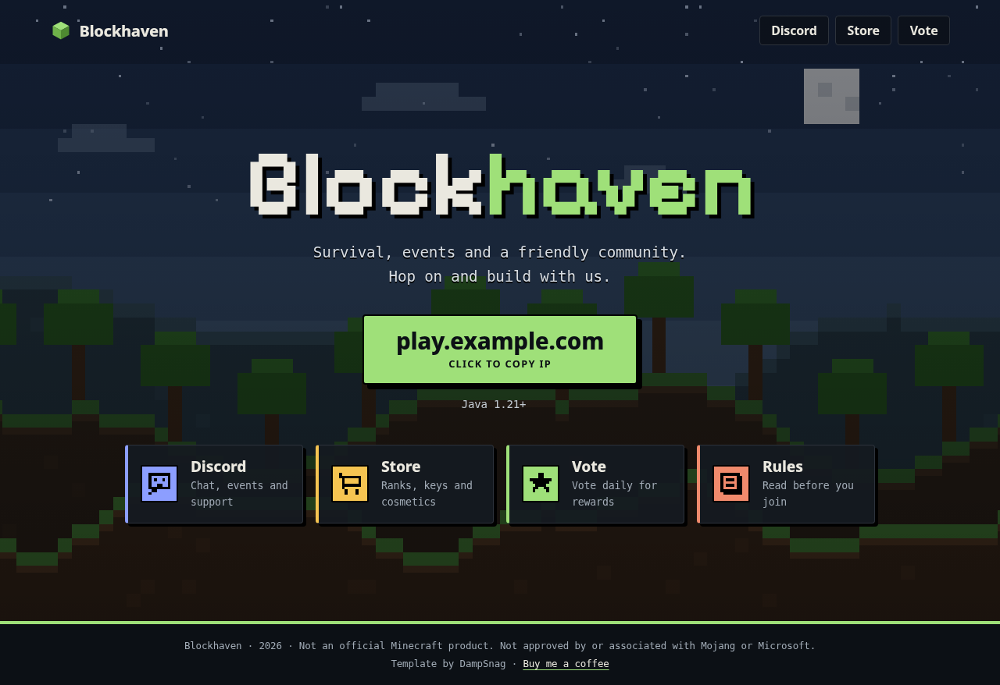
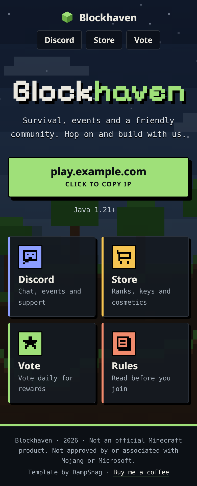

# Minecraft Server Portal Page

A one-screen landing page for your Minecraft server: a big pixel-style server name over a background image, a one-click **Copy IP** button, an optional live player count, and portal tiles linking to your Discord, store, vote page and rules. Plain HTML and CSS plus one small script. No build step, no frameworks, no trackers, nothing loaded from other sites.

> Not an official Minecraft product. Not approved by or associated with Mojang or Microsoft.

## Screenshots

| Desktop (1280px) | Mobile (390px) |
| --- | --- |
|  |  |

## Features

- Full-screen hero with your own background image and an adjustable dark overlay
- Chunky pixel heading (Pixelify Sans, bundled locally) with a two-colour server name
- Big copy-IP button with a press-down effect and "Copied!" message (announced to screen readers)
- Portal tiles and top-bar buttons, all set from one list in `config.js`
- Optional live player count from the public mcsrvstat.us API (off by default)
- Hover lifts and a short fade-in on load, turned off for visitors who prefer reduced motion
- Responsive (2-column tiles on phones), keyboard friendly, readable contrast

## Files

```
index.html               The page
style.css                Styles. Colours, corner radius and fonts are at the top
config.js                Your settings: name, IP, links, colours, images, tip link
main.js                  Applies config.js, builds the tiles, runs the copy button
assets/hero.svg          Placeholder background (replace with a screenshot of your server)
assets/logo.svg          Placeholder logo (also the favicon)
assets/fonts/            Pixelify Sans font + its licence (OFL.txt)
screenshots/             Images for this README (you can delete them)
LICENSE                  MIT
```

## Quick setup

1. Download the folder.
2. Open `config.js` and set your name, IP and links.
3. Put a screenshot of your server in `assets/` (e.g. `assets/hero.jpg`) and set `HERO_IMAGE` to it.
4. Swap `assets/logo.svg` for your logo.
5. Preview: open `index.html`, or run `python3 -m http.server` in the folder and visit `http://localhost:8000`.
6. Upload to any static host.

## config.js options

| Option | What it does |
| --- | --- |
| `NAME` | Server name (big title, top bar, footer, tab title) |
| `NAME_ACCENT` | The end part of the name shown in the accent colour, e.g. `"haven"`. `""` = one colour |
| `TAGLINE` | Line under the name |
| `IP` | Address players connect to (shown and copied) |
| `PORT` | Optional port. `""` or `25565` keeps it hidden |
| `VERSION` | Small note under the IP, e.g. `"Java 1.21+"`. `""` hides it |
| `LOGO` | Top-bar logo. `""` hides it |
| `HERO_IMAGE` | Background image path or URL. `""` = plain background colour |
| `HERO_OVERLAY` | Darkness of the overlay, `0` to `1` (default `0.45`). Raise it if text is hard to read |
| `COLORS.accent` | Main colour (IP button, highlights) |
| `COLORS.accentText` | Text colour on the accent (keep it dark on light accents) |
| `COLORS.background` | Page background |
| `LINKS` | List of tiles, see below |
| `STATUS` | `true` shows the live player count |
| `TIP_URL`, `TIP_LABEL` | Tip link in the footer credit |

### Links / tiles

Each entry in `LINKS` becomes a tile:

```js
{ label: "Discord", text: "Chat, events and support", url: "https://discord.gg/abc", icon: "chat", color: "#8C9EFF", nav: true }
```

- `icon`: `"chat"`, `"cart"`, `"star"`, `"book"`, `"sword"` or `""` for none
- `image`: optional picture (e.g. `"assets/store.png"`) shown instead of the icon
- `color`: the tile's accent colour
- `nav: true` also adds it as a button in the top bar
- An empty `url` hides the entry. Two to six tiles look best.

Other colours (`--surface`, `--border`, `--muted`), the corner radius (`--radius`) and fonts are custom properties at the top of `style.css`.

### Live player count (optional)

With `STATUS: true`, visitors' browsers ask the free public [mcsrvstat.us](https://mcsrvstat.us/) API how many players are online. It's a third-party service (it sees visitor IPs and caches results for a few minutes). If it can't be reached, the pill stays hidden. For Bedrock servers, change the URL in `main.js` to `https://api.mcsrvstat.us/bedrock/3/`.

## Deployment

Any static host works:

- **GitHub Pages:** push the folder to a repo, then Settings → Pages → deploy from branch, root folder.
- **Netlify, Cloudflare Pages, Vercel:** drag and drop the folder or connect the repo. No build command.
- **Regular web hosting:** upload the files via FTP or the file manager.

Copy to clipboard works best over HTTPS, which all of the above provide.

## Credit

Template by DampSnag. Keeping the footer credit is appreciated but not required. If this saved you time: [Buy me a coffee](https://dampsnag.com/coffee)

## Licence

Code: [MIT](LICENSE) © 2026 DampSnag.
Font: Pixelify Sans © The Pixelify Sans Project Authors, SIL Open Font License 1.1 (`assets/fonts/OFL.txt`).

Minecraft is a trademark of Mojang Synergies AB. This template is not affiliated with Mojang or Microsoft. The background, logo and icons are original placeholders.
